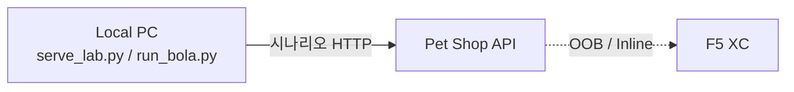

# BOLA lab scenario guide

기준 문서: **[PRD.md](PRD.md)**  
Pet Shop은 소유권을 검사하지 않습니다. 방어는 XC에서만 합니다.

## 역할 분리



| 위치 | 역할 |
|------|------|
| 로컬 `scenarios/` | 공격·정상 패턴 **트래픽 생성** |
| Pet Shop | 취약 **대상 API**만 |
| F5 XC | Discovery / BOLA / 이상행위 **탐지** (이 랩 밖) |

## P1 / P2 / P3 (반드시 분리)

| 그룹 | 의미 | 랩 키 |
|------|------|-------|
| **P1** 객체 BOLA | 권한 없는 객체 접근 | `cross_customer_bola`, `account_body_bola`, `id_enumeration` |
| **P2** 오탐·식별 | 정상 다계정/IP/토큰 | `operator_cyclic`, `operator_fixed`, `access_token_reissue` + `operator_code` |
| **P3** 이상행위 | 정상 후 급변 | `abnormal_probe` |
| 기본 | 베이스라인 | `public_catalog`, `self_order` |

IP 변경 ≠ BOLA. BOLA = 인증 주체가 권한 없는 객체에 접근하는 것.

### P1b Body Private Resource

```text
POST /api/v1/accounts/inquire
Authorization: Bearer <customer 410>
{ "accountNo": "10000001" }   # owner = customer 1
→ HTTP 200 (취약) · 로컬 라벨 bola
```

XC가 Path뿐 아니라 **Body `accountNo`** 를 Private Resource로 학습·탐지하는지 확인하는 시나리오입니다.

### P3 abnormal_probe

자기 주문 2건(정상) → 타인 주문 5건(BOLA). P2 순환과 대조합니다.

## 사용 (설치 → 실행)

### 로컬 GUI

```bash
cd scenarios
python3 serve_lab.py
# http://127.0.0.1:8765
```

Target = Pet Shop URL. 시나리오 클릭 시 **해당 옵션만** 표시.

### CLI (선택)

```bash
cd scenarios
python3 -m pip install -r requirements.txt
python3 run_bola.py --base http://192.168.47.81 --scenario account_body_bola
python3 run_bola.py --base http://192.168.47.81 --scenario abnormal_probe
python3 run_bola.py --base http://192.168.47.81 --scenario operator_cyclic --cyclic-ids 264
```

산출물: `out/*.jsonl`, `*.http.jsonl`, `*.summary.json`

## operator_code

| 모드 | JWT | 의미 |
|------|-----|------|
| OFF (기본) | 운영자 claim 없음 | 현재형 · 오탐 검토 |
| ON | `operator_code` 포함 | 미래형 · 운용사 식별 claim |

## 학습 기간

BOLA/행위 분석은 학습 트래픽·시간이 필요할 수 있습니다.  
실행 직후 XC 이벤트가 없다고 미지원으로 단정하지 마세요.

## OOB에서 이 랩이 증명하지 않는 것

실제 차단, Rate Limit Inline, 20K TPS, 미러링·마스킹 운영 — PRD Out of scope. Inline/별도 환경 필요.
