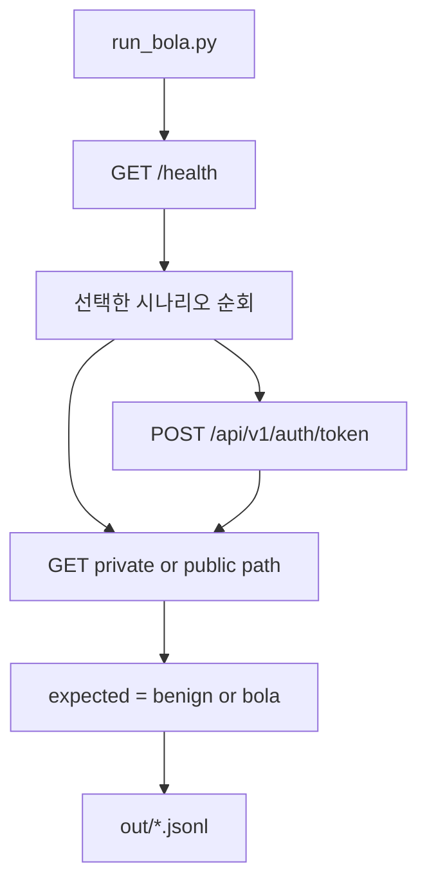
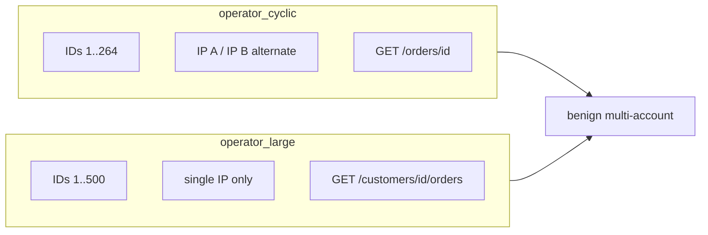
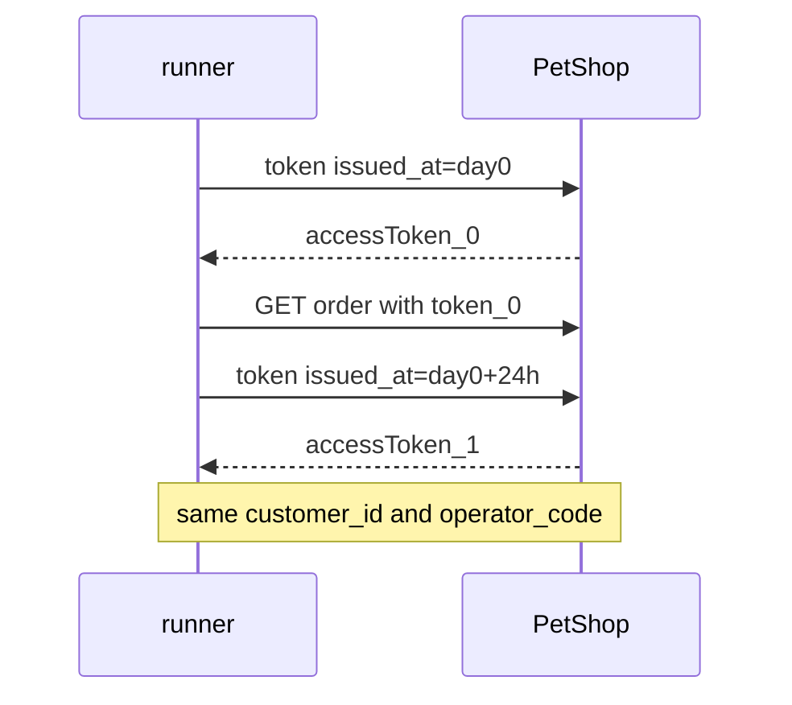
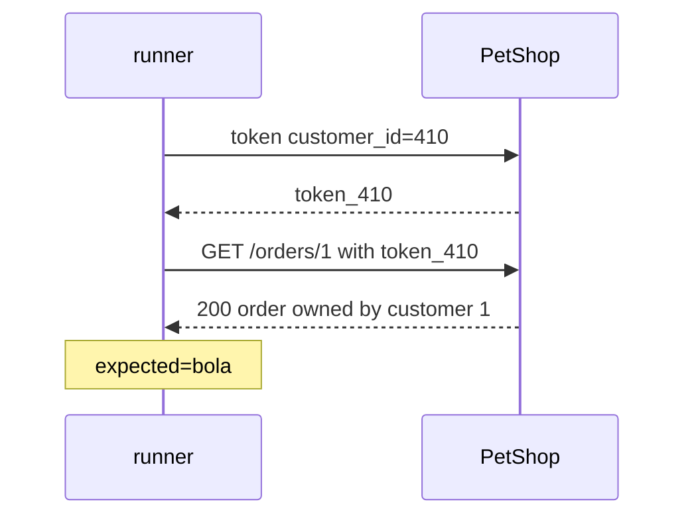

# BOLA lab scenario guide

문서와 러너를 같이 보면서 시나리오를 하나씩 실행할 수 있습니다.
방어는 XC에서만 하고, Pet Shop은 소유권을 검사하지 않습니다.

## Quick start

```bash
# API
curl -s http://192.168.47.81/health

# 시나리오 목록
cd ~/Downloads/XC-PoC/scenarios
python3 run_bola.py --list

# 한 개씩 (문서 읽으면서 테스트)
python3 run_bola.py --base http://192.168.47.81 --scenario operator_cyclic --cyclic 5
python3 run_bola.py --base http://192.168.47.81 --scenario operator_large --large 5
python3 run_bola.py --base http://192.168.47.81 --scenario cross_customer_bola

# 전체
python3 run_bola.py --base http://192.168.47.81
```

결과: `scenarios/out/*.jsonl`, `*.summary.json`  
각 줄의 `expected` 는 서버가 아니라 **러너가 로컬에서 붙인 정답 라벨**입니다.

---

## 전체 실행 흐름



공통 요청 형태:

```http
POST /api/v1/auth/token
Content-Type: application/json

{"customer_id": 1, "operator_code": "OP_CYCLE_A"}

GET /api/v1/orders/1
Authorization: Bearer <accessToken>
X-Forwarded-For: 203.0.113.10
```

라벨 규칙 (`bola_model.expected_label`):

- 본인 `customer_id`의 객체 → `benign`
- JWT `operator_code`에 **배정된** 계정 객체 → `benign`
- 그 외 타 계정 객체 → `bola`

서버는 위 규칙과 무관하게 private GET을 **항상 200**으로 줍니다.

---

## 순환형 vs 대규모 — 뭐가 다른가?

둘 다 “배정된 여러 계정을 돌아가며 조회”하는 **같은 계열(benign / 오탐 후보)** 입니다.
완전히 다른 공격이 아니라, **스케일·IP 조건·엔드포인트**가 다릅니다.

| | `operator_cyclic` | `operator_large` |
|--|-------------------|------------------|
| 운영자 | `OP_CYCLE_A` | `OP_LARGE` |
| 배정 계정 수 | **264** (`1..264`) | **500** (`1..500`) |
| 소스 IP | **2개 교대** (`…10`, `…11`) | **항상 1개** (`…50`) |
| 호출 경로 | `GET /api/v1/orders/{orderId}` | `GET /api/v1/customers/{id}/orders` |
| 의도 | 일반 순환형 멀티계정 | “한 IP에서 ID를 매우 많이” 쓰는 극단 케이스 |

즉 **대규모 = 순환형의 더 큰·더 빡센 IP 공유 버전**에 가깝습니다.
둘 다 `expected=benign` 이고 BOLA가 아닙니다.



### 예시: 순환형 처음 4번

| step | customer_id | operator_code | X-Forwarded-For | path |
|------|-------------|---------------|-----------------|------|
| 0 | 1 | OP_CYCLE_A | 203.0.113.10 | `/api/v1/orders/1` |
| 1 | 2 | OP_CYCLE_A | 203.0.113.11 | `/api/v1/orders/3` |
| 2 | 3 | OP_CYCLE_A | 203.0.113.10 | `/api/v1/orders/5` |
| 3 | 4 | OP_CYCLE_A | 203.0.113.11 | `/api/v1/orders/7` |

주문 ID = `(customer_id - 1) * 2 + 1` (고객당 주문 2개 중 첫 번째).

### 예시: 대규모 처음 3번

| step | customer_id | operator_code | X-Forwarded-For | path |
|------|-------------|---------------|-----------------|------|
| 0 | 1 | OP_LARGE | 203.0.113.50 | `/api/v1/customers/1/orders` |
| 1 | 2 | OP_LARGE | 203.0.113.50 | `/api/v1/customers/2/orders` |
| 2 | 3 | OP_LARGE | 203.0.113.50 | `/api/v1/customers/3/orders` |

테스트:

```bash
python3 run_bola.py --base http://192.168.47.81 --scenario operator_cyclic --cyclic 5
python3 run_bola.py --base http://192.168.47.81 --scenario operator_large --large 5
```

JSONL에서 `source_ip` / `customer_id` / `path` 차이를 비교하면 됩니다.

---

## 시나리오별 상세

### 1) `public_catalog` — benign

공개 카탈로그만 조회. 토큰 없음.

```bash
python3 run_bola.py --base http://192.168.47.81 --scenario public_catalog --catalog 5
```

예: `GET /api/v1/products`

---

### 2) `self_order` — benign

계정 410 토큰으로 **자기 주문**만 조회.

```text
POST /auth/token {"customer_id":410}
GET  /orders/819   # order_id_for(410)=819
```

```bash
python3 run_bola.py --base http://192.168.47.81 --scenario self_order
```

---

### 3) `operator_cyclic` — benign (오탐 후보)

위 표 참고. 배정 계정만 접근.

```bash
python3 run_bola.py --base http://192.168.47.81 --scenario operator_cyclic --cyclic 8
```

---

### 4) `operator_fixed` — benign (오탐 후보)

계정·`operator_code` 고정, **IP만** 바꿈.

| step | customer_id | operator_code | X-Forwarded-For | path |
|------|-------------|---------------|-----------------|------|
| 0 | 405 | OP_FIXED_A | 198.51.100.1 | `/api/v1/orders/809` |
| 1 | 405 | OP_FIXED_A | 198.51.100.2 | `/api/v1/orders/809` |
| 2 | 405 | OP_FIXED_A | 198.51.100.3 | `/api/v1/orders/809` |

```bash
python3 run_bola.py --base http://192.168.47.81 --scenario operator_fixed --fixed 4
```

---

### 5) `access_token_reissue` — benign

24시간 access_token 재발급 모델.
같은 `customer_id` / `operator_code`, `issued_at`만 하루씩 밀어 **iat/exp** 갱신 → 토큰 문자열만 변경.



```bash
python3 run_bola.py --base http://192.168.47.81 --scenario access_token_reissue
```

JSONL의 `issued_at`이 86400초씩 증가하고, 서버는 세 번 모두 200이어야 합니다.

---

### 6) `operator_large` — benign (오탐 후보)

순환형의 스케일 업. 단일 IP + 최대 500 ID.
위 비교 표 참고.

```bash
python3 run_bola.py --base http://192.168.47.81 --scenario operator_large --large 8
```

---

### 7) `cross_customer_bola` — bola

**진짜 BOLA.** 계정 410 토큰으로 계정 1의 객체를 읽음.
서버는 막지 않고 200 + 본문.



```text
POST /auth/token {"customer_id":410}
GET  /api/v1/orders/1
GET  /api/v1/payments/1
GET  /api/v1/customers/1
GET  /api/v1/pets/1/medical-records
```

```bash
python3 run_bola.py --base http://192.168.47.81 --scenario cross_customer_bola
```

순환형과 겉보기 GET은 비슷하지만, **배정/소유 관계가 없다**는 점이 다릅니다.

---

### 8) `id_enumeration` — bola (대부분)

계정 410 토큰 하나로 `orders/1,2,3…` 연속 조회.

```bash
python3 run_bola.py --base http://192.168.47.81 --scenario id_enumeration --enum 10
```

소유자가 410이 아닌 행은 `expected=bola`.

---

## Walkthrough 추천 순서

설명하면서 아래 순서로 돌리면 구분이 가장 잘 보입니다.

```bash
BASE=http://192.168.47.81
cd ~/Downloads/XC-PoC/scenarios

python3 run_bola.py --base $BASE --scenario self_order
python3 run_bola.py --base $BASE --scenario operator_cyclic --cyclic 5
python3 run_bola.py --base $BASE --scenario operator_large --large 5
python3 run_bola.py --base $BASE --scenario operator_fixed --fixed 4
python3 run_bola.py --base $BASE --scenario access_token_reissue
python3 run_bola.py --base $BASE --scenario cross_customer_bola
python3 run_bola.py --base $BASE --scenario id_enumeration --enum 8
```

각 실행 후 최신 `out/bola-run-*.jsonl`에서 `scenario`, `expected`, `source_ip`, `customer_id`, `path`만 보면 됩니다.

---

## XC에 넘길 때

| 라벨 | 의미 |
|------|------|
| benign (cyclic / large / fixed / reissue) | 정상인데 IP·토큰 문자열만 보면 이상으로 보일 수 있음 → **오탐 검토** |
| bola (cross / enum) | 타 객체 접근·열거 → **탐지 대상** |

앱이 403을 주지 않는 것이 의도입니다. 성공한 BOLA를 XC가 볼 수 있어야 합니다.
