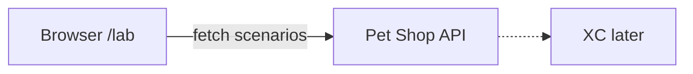
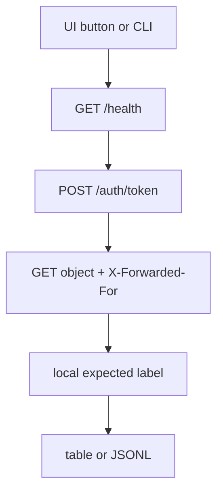

# BOLA lab scenario guide

Pet Shop은 소유권을 검사하지 않습니다. 방어는 XC에서만 합니다.

## GUI (권장)

추가 패키지 없이 **브라우저만** 사용합니다 (Windows / macOS).

1. Pet Shop이 떠 있는지 확인: `http://192.168.47.81/health`
2. 랩 UI 열기: **[http://192.168.47.81/lab](http://192.168.47.81/lab)**
3. 상단에서 설정
   - **순환 ID 개수**: 1–500 (예: 264 또는 500)
   - **토큰에 operator_code**: OFF = 현재형(오탐 검토) / ON = 미래형(운영자 claim)
4. 시나리오 버튼 클릭 → 아래 표에 결과 표시

로컬 Docker만 쓸 때도 동일하게 `http://127.0.0.1/lab` (또는 포트 포함 URL).



---

## operator_code ON / OFF

| 모드 | JWT | 의미 |
|------|-----|------|
| **OFF (기본)** | `customer_id` 만 | 지금처럼 토큰에 운영자 구분이 없음. 같은 IP·다계정 → XC **오탐** 후보 |
| **ON** | `customer_id` + `operator_code` | 토큰에 운영자 신원이 있을 때 XC가 어떻게 묶는지 비교 |

순환형에서 각 요청은 **그 계정의 자기 주문**을 치므로, 라벨상으로는 둘 다 `benign`일 수 있습니다.  
차이는 XC가 보는 **토큰 claim**입니다. OFF면 운영자 묶음이 없고, ON이면 `OP_CYCLE_A` 등으로 묶을 수 있습니다.

CLI:

```bash
# 현재형 (operator_code 없음) — 기본
python3 run_bola.py --base http://192.168.47.81 --scenario operator_cyclic --cyclic-ids 264

# 미래형 (operator_code 포함)
python3 run_bola.py --base http://192.168.47.81 --scenario operator_cyclic --cyclic-ids 264 --operator-code
```

---

## 순환형 ID 개수 (264 / 500은 같은 시나리오)

예전 `operator_large`는 제거했습니다.  
**하나의 `operator_cyclic`** 에서 `--cyclic-ids` (GUI: 순환 ID 개수)만 바꿉니다.

| cyclic-ids | IP | 비고 |
|------------|----|------|
| ≤264 (기본 264) | IP 2개 교대 | 일반 순환 |
| 265–500 | IP 1개 | 스케일 스트레스 |

패턴은 동일: 배정(또는 자기) 계정 주문을 돌아가며 조회 → **benign**.

---

## 전체 흐름



---

## 시나리오 목록

| id | expected | 설명 |
|----|----------|------|
| `public_catalog` | benign | 공개 GET |
| `self_order` | benign | 본인 주문 |
| `operator_cyclic` | benign | 멀티계정 순환 (ID 개수 조절) |
| `operator_fixed` | benign | ID 고정, IP만 변경 |
| `access_token_reissue` | benign | 24h access_token 재발급 |
| `cross_customer_bola` | bola | 타 계정 객체 조회 |
| `id_enumeration` | bola | 연속 ID 열거 |

### cross_customer_bola 예시

```text
token: customer_id=410  (operator_code 없음)
GET /api/v1/orders/1     → 소유자 1 → expected=bola, HTTP 200
```

### operator_cyclic 예시 (ids=3, operator_code OFF)

```text
token customer_id=1  → GET /orders/1   IP …10
token customer_id=2  → GET /orders/3   IP …11
token customer_id=3  → GET /orders/5   IP …10
JWT에 operator_code 없음
```

### operator_cyclic 예시 (ids=3, operator_code ON)

```text
token customer_id=1, operator_code=OP_CYCLE_A → GET /orders/1
...
```

---

## CLI (선택)

GUI가 기본입니다. 자동화가 필요하면:

```bash
cd scenarios
python3 -m pip install -r requirements.txt   # requests 만
python3 run_bola.py --list
python3 run_bola.py --base http://192.168.47.81 --scenario operator_cyclic --cyclic-ids 500 --cyclic 20
python3 run_bola.py --base http://192.168.47.81 --scenario cross_customer_bola --operator-code
```

`requests`가 없으면 GUI(`/lab`)만 써도 됩니다.
