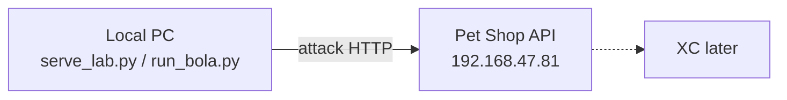

# BOLA lab scenario guide

Pet Shop은 소유권을 검사하지 않습니다. 방어는 XC에서만 합니다.

## 역할 분리



| 위치 | 역할 |
|------|------|
| 로컬 `scenarios/` | 공격 시나리오 UI·CLI |
| `192.168.47.81` | 취약한 **대상 API**만 |

서버 `/lab` 은 “로컬에서 실행하세요” 안내만 합니다.

## GUI (로컬, 권장)

```bash
cd scenarios
python3 serve_lab.py
# http://127.0.0.1:8765
```

1. **Target Base URL** = `http://192.168.47.81`
2. 왼쪽 attack type 선택 → **Expected flow** / **Example behavior** 확인
3. 옵션별 설명 확인 후 실행 (요청은 로컬 브라우저 → 대상 API)
4. 하단 HTTP log · JSONL로 검증

### 옵션 설명

| 옵션 | 설명 |
|------|------|
| Target Base URL | 대상 Pet Shop. 로컬 UI 주소가 아님 |
| 순환 ID 개수 | `operator_cyclic` 전용, 1–500. ≤264 → IP 2개 교대 / 265+ → IP 1개 |
| 순환 샘플 수 | 순환형에서 보낼 GET 횟수 |
| 고정형 샘플 수 | `operator_fixed`에서 IP를 바꿔 보내는 횟수 |
| 열거 개수 | `id_enumeration`에서 연속 order ID 개수 |
| operator_code OFF | 현재형. JWT에 운영자 claim 없음 → 오탐 검토 |
| operator_code ON | 미래형. JWT에 `operator_code` 포함 |

---

## operator_code ON / OFF

| 모드 | JWT | 의미 |
|------|-----|------|
| **OFF (기본)** | `customer_id` 만 | 지금처럼 토큰에 운영자 구분이 없음. 같은 IP·다계정 → XC **오탐** 후보 |
| **ON** | `customer_id` + `operator_code` | 토큰에 운영자 신원이 있을 때 XC가 어떻게 묶는지 비교 |

순환형에서 각 요청은 **그 계정의 자기 주문**을 치므로 라벨은 `benign`일 수 있습니다.  
차이는 XC가 보는 **토큰 claim**입니다.

```bash
python3 run_bola.py --base http://192.168.47.81 --scenario operator_cyclic --cyclic-ids 264
python3 run_bola.py --base http://192.168.47.81 --scenario operator_cyclic --cyclic-ids 264 --operator-code
```

---

## 순환형 ID 개수

예전 `operator_large`는 제거. **`operator_cyclic` + ID 개수**만 사용합니다.

| cyclic-ids | IP | 비고 |
|------------|----|------|
| ≤264 (기본 264) | IP 2개 교대 | 일반 순환 |
| 265–500 | IP 1개 | 스케일 스트레스 |

---

## 시나리오 목록

| id | expected | 설명 |
|----|----------|------|
| `public_catalog` | benign | 공개 GET |
| `self_order` | benign | 본인 주문 |
| `operator_cyclic` | benign | 멀티계정 순환 (ID 개수 조절) |
| `operator_fixed` | benign | ID 고정, IP만 변경 |
| `access_token_reissue` | benign | 24h access_token 재발급 |
| `cross_customer_bola` | bola | 타 계정 객체 조회 |
| `id_enumeration` | bola | 연속 ID 열거 |

### cross_customer_bola 예시

```text
token: customer_id=410  (operator_code 없음)
GET /api/v1/orders/1     → 소유자 1 → expected=bola, HTTP 200
```

### operator_cyclic 예시 (ids=3, operator_code OFF)

```text
token customer_id=1  → GET /orders/1   IP …10
token customer_id=2  → GET /orders/3   IP …11
token customer_id=3  → GET /orders/5   IP …10
JWT에 operator_code 없음
```

---

## CLI

```bash
cd scenarios
python3 -m pip install -r requirements.txt
python3 run_bola.py --list
python3 run_bola.py --base http://192.168.47.81 --scenario operator_cyclic --cyclic-ids 500 --cyclic 20
python3 run_bola.py --base http://192.168.47.81 --scenario cross_customer_bola
```

| 파일 | 용도 |
|------|------|
| `bola-run-*.jsonl` | 시나리오 요약 라벨 |
| `bola-run-*.http.jsonl` | 요청·응답 전체 |
| `bola-run-*.summary.json` | benign/bola 집계 |
